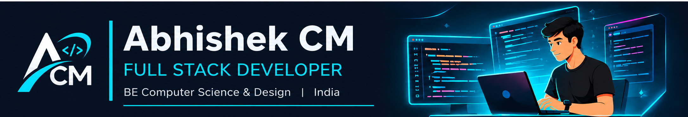

<!-- ===================================================== -->
<!--                  ABHISHEK CM                         -->
<!--              PREMIUM GITHUB PROFILE                  -->
<!-- ===================================================== -->

<p align="center">
  
</p>

<div align="center">


<br/>

### `BUILDING THE FUTURE, ONE PROJECT AT A TIME`

<p>
  <a href="mailto:abhishekcm8275@gmail.com">
    
  </a>
  <a href="https://github.com/Abhishek-cm10">
    
  </a>
  <a href="https://www.linkedin.com/in/abhishek-cm-734bb52a8/">
    
  </a>
</p>


</div>

---

<h2 align="center">⚡ ABOUT ME</h2>

<table>
<tr>
<td width="55%" valign="top">

### 👨‍💻 Who I Am

I'm a Computer Science and Design graduate passionate about software development, modern web technologies and emerging innovations.

- 🎓 BE in Computer Science and Design
- 💻 Aspiring Software Engineer
- 🌐 Interested in Full Stack Development
- 🔗 Exploring Blockchain and Cryptography
- 🤖 Interested in AI and Machine Learning
- 🌱 Continuously learning and improving

</td>
<td width="45%" valign="top">

### 🎯 Current Focus

```javascript
const abhishek = {
  role: "Full Stack Developer",
  interests: [
    "Web Development",
    "Blockchain",
    "Artificial Intelligence"
  ],
  technologies: [
    "React",
    "Node.js",
    "MongoDB",
    "Java",
    "Python",
    "Solidity"
  ],
  mindset: "Learn. Build. Improve."
};
```

</td>
</tr>
</table>

---

<h2 align="center">🛠️ TECHNICAL ARSENAL</h2>

<div align="center">

### 💻 Programming Languages


### 🎨 Frontend Development


### ⚙️ Backend Development


### 🗄️ Databases


### ⛓️ Blockchain Technologies


<p>
  
  
  
  
</p>

### 🤖 AI & Machine Learning

<p>
  
  
  
  
  
</p>

### 🔧 Tools & Platforms


</div>

---

<h2 align="center">🚀 FEATURED PROJECTS</h2>

<p align="center">
  <i>Turning concepts into practical software solutions.</i>
</p>

<table>
<tr>
<td width="50%" valign="top">

<h3>🛒 FCART</h3>
<h4>Multi-Vendor E-Commerce Platform</h4>

<p>
  
</p>

A full-stack e-commerce platform designed to support buyers, sellers and administrators through dedicated role-based functionality.

**Technology Stack**

`React.js` `Node.js` `Express.js` `MongoDB`

**Key Features**

- 🔐 User authentication
- 🛍️ Product browsing and shopping cart
- ❤️ Wishlist functionality
- 🏪 Multi-vendor seller management
- 📦 Product and order management
- 👥 Buyer, seller and admin dashboards
- 💳 Payment integration

<p align="center">
  <a href="https://github.com/Abhishek-cm10">
    
  </a>
</p>

</td>
<td width="50%" valign="top">

<h3>🔗 DECRYPT 2.0</h3>
<h4>Blockchain & Cryptography Platform</h4>

<p>
  
</p>

A decentralized finance application developed as a Blockchain and Cryptography mini-project, integrating Ethereum wallet connectivity, smart contracts and a modern financial dashboard.

**Technology Stack**

`React` `Vite` `Solidity` `Hardhat` `Ethers.js`

**Key Features**

- 🔐 MetaMask wallet integration
- 💸 ETH and ERC20 transfers
- 🔄 Uniswap V2-compatible swap interface
- 🏦 ETH and ERC20 vault smart contracts
- 📊 Portfolio and market dashboard
- 🌗 Premium dark and light themes
- 🧪 Automated smart contract tests

<p align="center">
  <a href="https://github.com/Abhishek-cm10/Blockchain-and-Cryptography">
    
  </a>
</p>

</td>
</tr>

<tr>
<td width="50%" valign="top">

<h3>🌿 MEDICINAL PLANT DETECTION</h3>
<h4>AI & Machine Learning Application</h4>

A machine learning-based application that identifies medicinal plants using image classification.

**Technology Stack**

`Python` `TensorFlow` `Keras` `MobileNetV2` `Flask` `SQLite`

**Key Features**

- 🌱 Image-based plant identification
- 🤖 Deep learning classification
- 🖼️ Dataset processing
- 📊 Prediction results
- 🗄️ SQLite database integration

<p align="center">
  <a href="https://github.com/Abhishek-cm10/Detection-of-Medicinal-Plants">
    
  </a>
</p>

</td>
<td width="50%" valign="top">

<h3>📊 CLUSTERING OF PATTERNS</h3>
<h4>Data Analysis & Machine Learning</h4>

A data analysis project focused on discovering patterns and grouping similar data points using clustering concepts.

**Focus Areas**

- 📈 Data analysis
- 🧹 Data preprocessing
- 🧠 Clustering techniques
- 🔍 Pattern recognition
- 📊 Data visualization

</td>
</tr>
</table>

---

<h2 align="center">🌐 MY PORTFOLIO</h2>

<div align="center">

A central place to explore my development journey, technical skills and projects.

<br/>

<a href="https://github.com/Abhishek-cm10/abhishek-portfolio">
  
</a>

</div>

---

<h2 align="center">📊 GITHUB ANALYTICS</h2>

<div align="center">


<br/><br/>


</div>

---

<h2 align="center">🐍 CONTRIBUTION JOURNEY</h2>

<div align="center">


</div>

---

<h2 align="center">🤝 LET'S CONNECT</h2>

<div align="center">

<p>I'm always interested in connecting with developers, exploring opportunities and collaborating on meaningful projects.</p>

<a href="mailto:abhishekcm8275@gmail.com">
  
</a>

<a href="https://github.com/Abhishek-cm10">
  
</a>

<a href="https://www.linkedin.com/in/abhishek-cm-734bb52a8/">
  
</a>

<br/><br/>

### 💡 CODE. CREATE. LEARN. REPEAT.

*Building my future, one commit at a time.* 🚀

<br/>


</div>

<!-- END OF PROFILE README --> 
